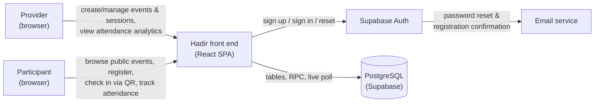
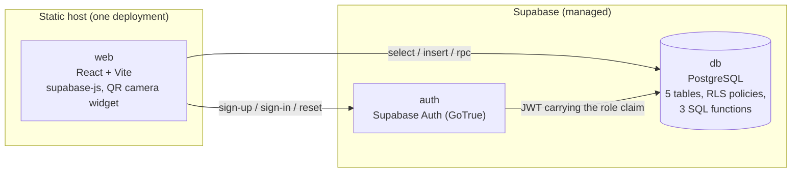
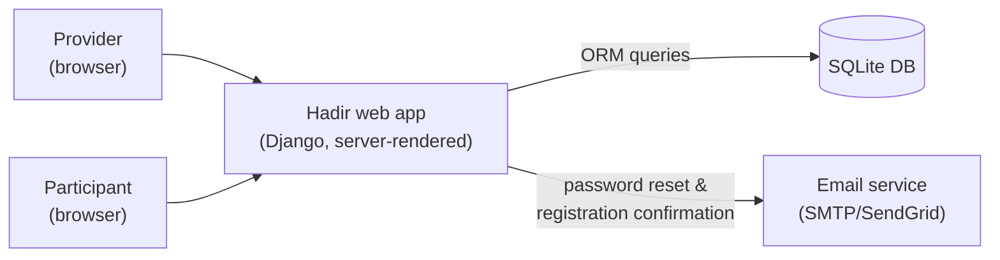
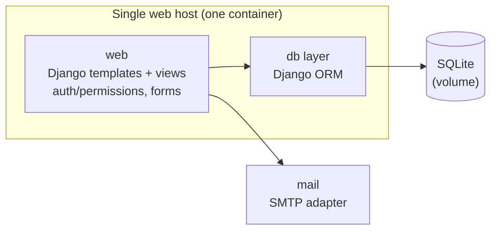

# Hadir (حاضر) — M1 Architecture

> SWE 485 — Advanced Software Engineering with AI (Term 1 1448 AH)
> Milestone M1 | Part of the M1 package.
>
> Two genuinely distinct options with C4 Context and Container diagrams (Mermaid),
> a trade-off matrix, a coupling check, and a cost pointer. The detailed cost
> arithmetic lives in [`cost-model.md`](./cost-model.md); the coupling evidence
> lives in [`coupling-report.md`](./coupling-report.md).
>
> **Chosen: Option A — React front end on Supabase** ([ADR-0004](./adr/0004-adopt-react-on-supabase-over-django.md)).
> Option B — Django monolith — was the earlier recommendation and is now rejected;
> see [ADR-0001](./adr/0001-adopt-django-monolith-over-firebase.md) and
> [ADR-0002](./adr/0002-sqlite-via-django-orm.md), both superseded.

---

## 1. Context

Hadir is a **web-only** platform. Two roles: **Provider** (creates events/sessions,
runs QR attendance, exports, analytics) and **Participant** (browses public events,
registers, checks in via QR, tracks attendance). Persistence is PostgreSQL. Email is
used for password reset and registration confirmation.

The build is delivered by **one developer**, so the architecture is judged on the code
that developer must write and operate, not on the size of the diagram.

---

## 2. Option A — React front end on Supabase (RECOMMENDED)

A React single-page front end on a static host, backed by Supabase: Supabase Auth for
identity, a managed PostgreSQL database for data, Row Level Security (RLS) for
authorization, and three SQL functions for the rules that carry the product's integrity.

### C4 — Context diagram

### C4 — Container diagram

**Containers:** `web` (React + Vite, the `supabase-js` client, and one QR camera
widget), `auth` (Supabase Auth), `db` (PostgreSQL: 5 tables, RLS policies, and three
SQL functions). Two targets, both managed: the static host and Supabase. No server is
operated by the team.

### Where each rule lives (one home per rule)

| Rule | Single home |
|---|---|
| `present`/`late` status (AT-01) | SQL function `check_in()` reading `now()` |
| Capacity-limited registration (PB-07) | SQL function `register_for_event()`, one transaction |
| Attendance rate (AN-01) | SQL function `attendance_rate()`, guarded against division by zero |
| Access control (NFR-2) | RLS policies on all five tables |
| Session / event lifecycle (SE-06, PB-03) | Derived at read from `closes_at` / `registration_deadline` |
| Rendering | React components (one layer) |
| Email | Supabase Auth (reset and confirmation) |

### Why the check-in clock becomes structural

The status cannot be forged because the client has no path to supply a timestamp:
`check_in()` reads `now()` inside the database, so NFR-4 changes from "write the view
correctly" to "there is no way to write it wrongly". This is the strongest form of the
residual-risk mitigation available to the project.

---

## 3. Option B — Django monolith + server-rendered UI

A single Django project on one container. Server-rendered templates for the UI, the
Django ORM for persistence, Django auth/permissions for access control, and one JSON
view for the live poll. No separate API layer.

### C4 — Context diagram

### C4 — Container diagram

**Containers:** `web` (Django templates/views), `db` (SQLite), `mail` (SMTP
adapter). One target: one container plus a SQLite volume.

---

## 4. Distinctness check (are these genuinely different?)

| Dimension | Option A (React + Supabase) | Option B (Django monolith) |
|---|---|---|
| Who runs the server | Vendor-managed services | The team (one container) |
| Frontend rendering | Client-rendered (React SPA) | Server-rendered (Django templates) |
| Business logic location | SQL functions inside the database | Python services |
| Access control | RLS policies at the database boundary | Role checks in views |
| Persistence access | `supabase-js` (PostgREST + RPC) | Django ORM |
| Identity | Supabase Auth | Django auth |
| Real-time attendance | `select` polled every 5 s | View polled every 5 s |
| Admin surface | Supabase Studio | Django admin |

These differ across **deployment model, rendering, logic location, access control,
identity, and persistence access** — not merely a rename of the same architecture. **The
distinctness check passes.**

---

## 5. Trade-off matrix

| Criterion | Option A (React + Supabase) | Option B (Django monolith) |
|---|---|---|
| Code volume for one developer | **Small** — auth, sessions, reset, admin, email are managed | Large — ORM, auth, forms, admin, templates |
| Operational surface | **No server to run** (two managed targets) | One container to run, plus the DB |
| Explainability / defense at M4 | Weaker (BaaS behaviour; SQL + RLS to explain) | **Strong** (own Python code) |
| Mutation testing in the declared language | Weak (SQL / TypeScript) | **Strong** (`pytest` + `mutmut`) |
| Access control correctness | **One boundary** (RLS), cannot be forgotten per route | Per-route checks that can be forgotten |
| Clock integrity for the status rule | **Structural** — `now()` inside the database | Correct only if the view is written correctly |
| Capacity correctness | **Transactional by construction** | Needs `transaction.atomic` + row locking |
| Cost | **Free tier, $0** | ~$5–10/month, fixed |
| Vendor lock-in | High | **None** |
| Learning value | Managed-platform experience | Framework fundamentals |

---

## 6. Coupling check

Option A keeps **one enforcement point per rule**: the status rule, capacity rule, and
attendance rate each live in exactly one SQL function; authorization lives in RLS; the
React layer renders and never re-implements a rule. Option B keeps one home per rule too,
but in a single codebase the developer can drift into per-route checks. The earlier
AI-assembled draft — which mixed a Django backend, an SPA, and a BaaS store — remains
flagged for dual source-of-truth, multi-place auth, and split persistence. See
[`coupling-report.md`](./coupling-report.md) for the evidence and the residual risk.

---

## 7. Cost model (summary)

Full arithmetic is in [`cost-model.md`](./cost-model.md). Summary with the stated usage
assumptions:

- **Option A:** Supabase free tier (PostgreSQL, Auth, 500 MB database) + a free static host
  = **$0/month** at the assumed load, with usage limits rather than a bill. **Zero fixed cost,
  bounded by quotas.**
- **Option B:** one small VPS/container (fixed ~$5–10) + email via SendGrid free tier.
  **Near-fixed, predictable cost, one target.**

Option A is chosen on code volume and access-control correctness, not on price — it happens
to be the cheaper of the two at this scale (~$0–1 vs ~$6–8/month), so price does not decide
the choice. Option B remains the more predictable of the two on cost *shape* (one fixed host).

---

## 8. Recommendation

**Adopt Option A (React front end on Supabase).** Rationale:

1. It removes the largest block of code a single developer would otherwise write — identity,
   sessions, password reset, admin, and email — while keeping every in-scope requirement.
2. **Access control becomes one boundary.** An RLS policy applies to every query, so a route
   cannot silently lose its authorization check.
3. **The clock rule becomes structural.** `check_in()` reads `now()` inside the database, so a
   forged client timestamp has no path into the status decision (NFR-4).
4. **Capacity is transactional by construction** in `register_for_event()` (PB-07).
5. It leaves no server for one developer to operate, patch, or keep awake.

### Accepted downsides

- **Two managed targets** instead of one: the static host and Supabase. The
  "one deployment target" ceiling is **knowingly broken**, and recorded as such in
  [ADR-0004](./adr/0004-adopt-react-on-supabase-over-django.md).
- **Weaker mutation evidence.** The declared stack is no longer Python, so the Week 10
  mutation work moves to SQL and TypeScript, where the tooling is thinner.
- **Vendor coupling.** Authentication, database, and email all depend on one provider.

### Residual risk (the coupling detector cannot see this)

The role claim now travels in a JWT. If the role is stored in `user_metadata` — which the
user can edit — a participant can promote themselves to Provider, and every RLS policy will
honour the forged claim. **Mitigation:** the role lives in `app_metadata` only (server-set),
and a policy is never written against a client-writable field. Enforced by the negative test
`test_participant_cannot_create_event` in [`risk-register.md`](./risk-register.md) R-08.

A second residual risk is silent failure: an RLS policy that is too narrow returns **zero
rows with no error**, so a broken policy looks like an empty list rather than a denial.
**Mitigation:** every table has a positive test (the owner sees the row) and a negative test
(the other role sees zero rows) — see the acceptance criteria for NFR-2.

Related requirement IDs: **AT-01, AT-02, NFR-2, NFR-4, PB-07, AN-01**.
